<div align="center">


# Intake

**A self-hosted nutrition and health dashboard for one person**
Daily meal timeline · macros · meal plans · Apple Health sleep, activity and heart · Hevy training

<p>
  
  
  
  
  
  
  
  
  
</p>

<p>
  <a href="#-screenshots">Screenshots</a> ·
  <a href="#-features">Features</a> ·
  <a href="#-how-it-works">How it works</a> ·
  <a href="#-development">Development</a> ·
  <a href="#-deployment">Deployment</a> ·
  <a href="#-documentation">Docs</a>
</p>

</div>

---

Intake reads what you log by talking to Claude (meals, water, weight, goals) **live** from the
[Nutrition MCP server](https://nutrition-mcp.com/mcp), lays it out as a timeline next to your meal plan, and adds sleep,
steps, heart rate and workouts from **Apple Health** and **Hevy**. It runs on your own server, signs in only you, and works
as an installed app on iPhone, iPad and desktop, in light and dark mode. The interface is in Italian, English or Dutch.

## ✨ Highlights

| | |
|---|---|
| 🎯 **Effort · Recovery · Sleep** | Three daily percentages on Today, computed from workouts, resting heart rate, respiratory rate, sleep and (with an Apple Watch) HRV. Tap a ring to see how it is calculated. |
| 🕒 **Timeline** | Meals, the planned meals still to log, workouts with their heart-rate curve and last night's sleep on one rod, with a "now" marker. |
| 📋 **Meal plans** | Upload the plan generated by Claude Fitness; log a planned meal with one tap, skip it, and compare plan and reality. |
| 📊 **Trends** | Weekly nutrition (calories, protein, kcal share, consistency), health trends over 7, 30 or 90 days, and training from Hevy: the next routine with progression hints and load charts. |
| ❤️ **Apple Health** | Automatic hourly sync from Health Auto Export, or file import with a preview; duplicates across Fitbit, MERACH, Bevel and Hevy merged into one session. |
| 🔔 **Reminders** | Web Push to the installed app: planned meals, water, the evening summary. |
| 🔒 **Private by design** | Google sign-in for the owner only, secrets encrypted at rest, nutrition data never copied to the local database. |

The interface is in Italian by default (English and Dutch in Profile › Language); this README uses English names for the screens (the Italian label is given once in parentheses).

## 📸 Screenshots

> Screenshots use made-up demo data.

<table>
  <tr>
    <td align="center">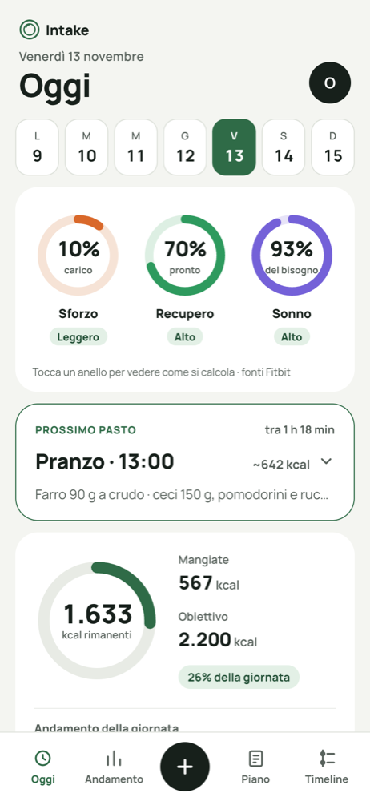<br /><sub><b>Today</b> · rings, next meal, calories</sub></td>
    <td align="center">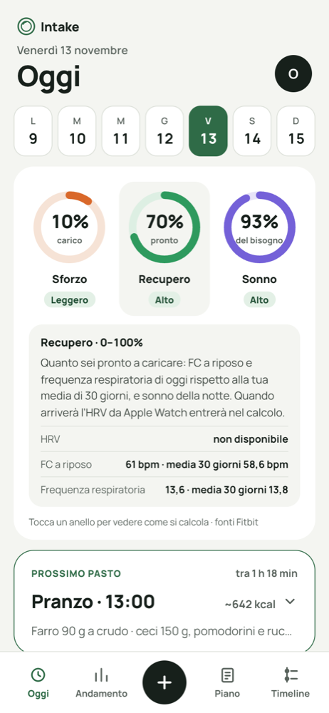<br /><sub><b>Recovery</b> · how it is calculated</sub></td>
    <td align="center">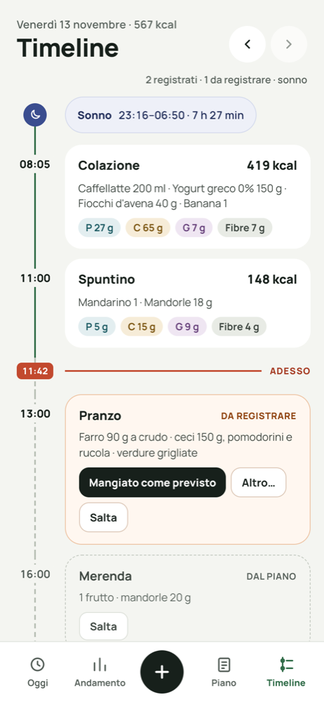<br /><sub><b>Timeline</b> · meals, plan, now</sub></td>
    <td align="center">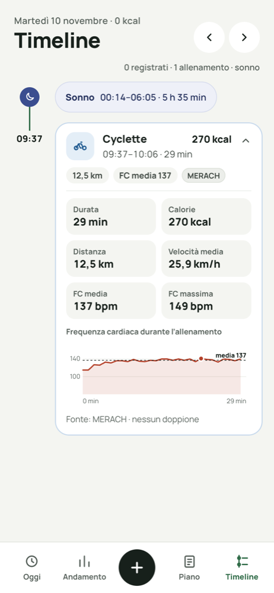<br /><sub><b>Workout</b> · heart-rate curve</sub></td>
  </tr>
  <tr>
    <td align="center">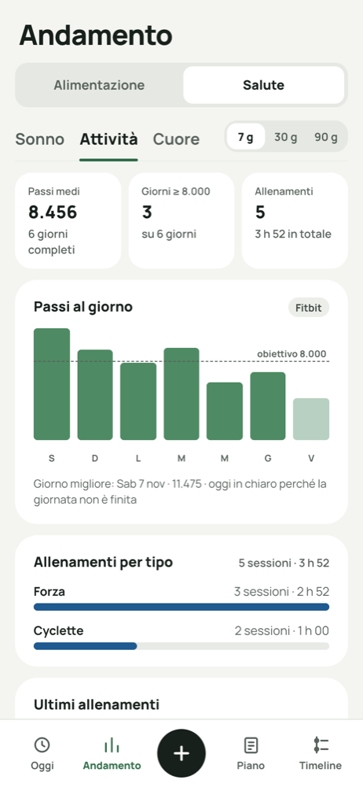<br /><sub><b>Trends › Health</b></sub></td>
    <td align="center">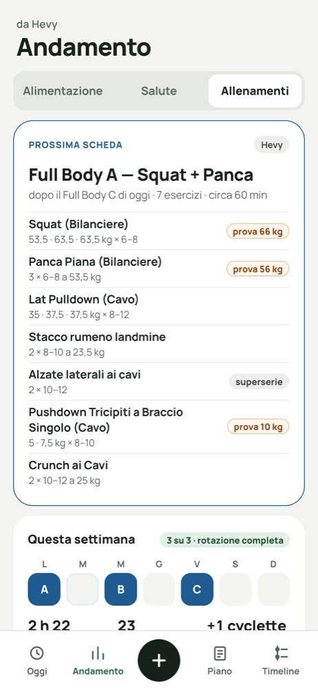<br /><sub><b>Trends › Training</b> · next routine</sub></td>
    <td align="center">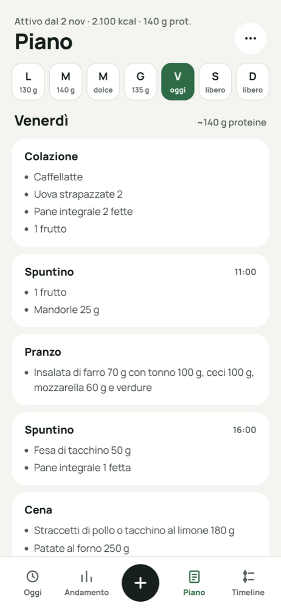<br /><sub><b>Plan</b> · the week's plan</sub></td>
    <td align="center">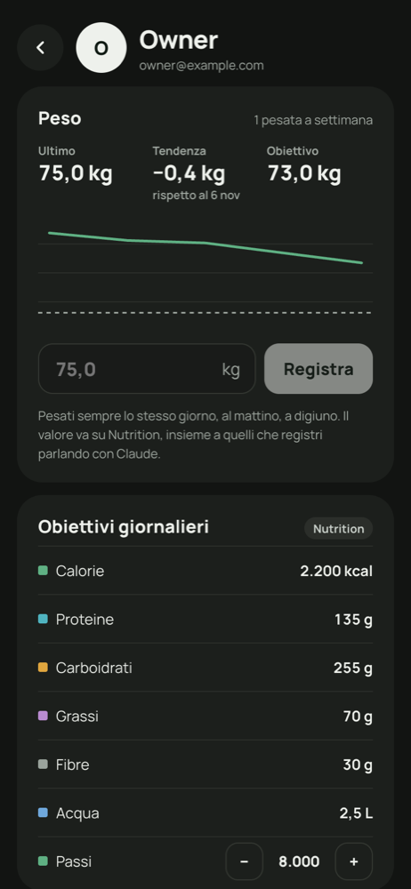<br /><sub><b>Profile</b> · dark mode</sub></td>
  </tr>
</table>

<p align="center">
  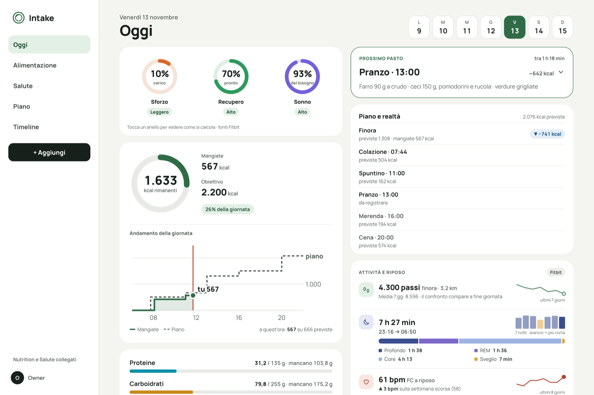<br />
  <sub><b>Today on desktop</b> · sticky sidebar, two columns</sub>
</p>

<p align="center">
  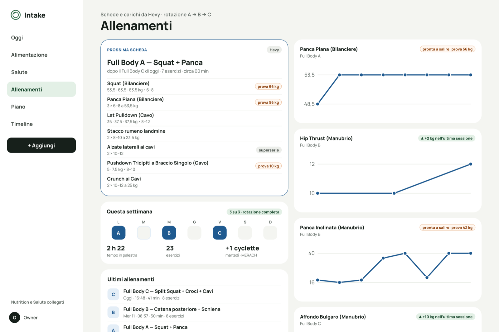<br />
  <sub><b>Trends › Training on desktop</b> · next routine, week, one card per lift</sub>
</p>

<table>
  <tr>
    <td align="center">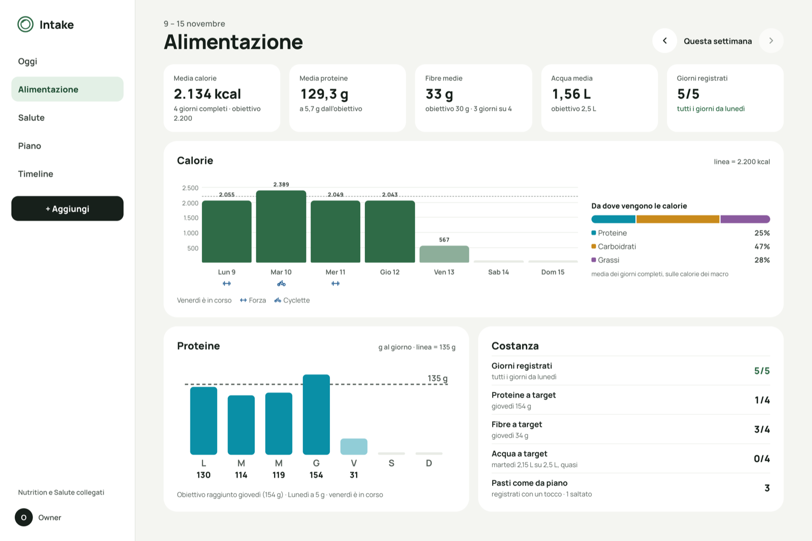<br /><sub><b>Trends › Nutrition</b></sub></td>
    <td align="center">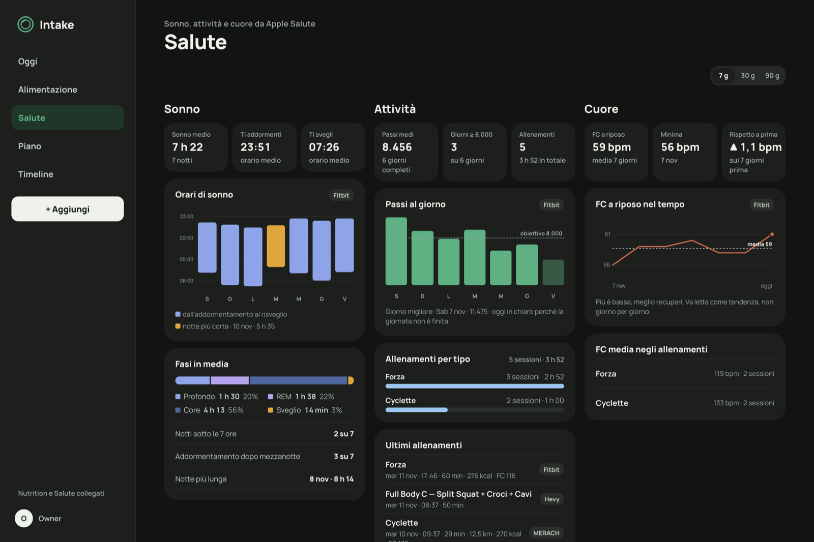<br /><sub><b>Trends › Health</b> · dark mode</sub></td>
  </tr>
</table>

## 🧩 Features

<details open>
<summary><b>🏠 Today (Oggi)</b></summary>

- Effort, Recovery and Sleep rings (Sforzo / Recupero / Sonno) at the top of Today, after an Apple Health import: three percentages with a text state (light / moderate / intense, low / medium / high); tap a ring for "how it is calculated" with the day's inputs. Effort from workout heart rate (TRIMP) and the day's movement; Sleep against an 8-hour need with a bedtime-regularity correction; Recovery from HRV when an Apple Watch writes it, otherwise resting heart rate and respiratory rate against the personal 30-day baseline, plus Sleep ("calibrating" until there is enough history; a new watch shows "HRV calibrating · N of 5 days"). Rules in [docs/apple-health.md](docs/apple-health.md) (`GET /api/health/scores/:date`).
- Calorie ring (eaten / goal / remaining) with a daily progress chart under it: kcal eaten through the day as a stepped line with area against the plan as a dashed stepped line, 06–22, the "now" marker and "so far: X of Y planned" (hidden on days without meals or plan). Macro bars for protein, carbs, fat and fiber with remaining or excess amounts; water in liters as 250 ml glasses with a quick "+250 ml" button (idempotent, optimistic update).
- Today shows the day's recap (calorie ring, macros, water), the next meal and a daily insight; from 1000 px the recap and the cards are two columns, on phones the next meal comes first. The week strip has ‹ › arrows to move a week back or forward (never past the current week), and "Day timeline →" under the title opens the Timeline of the day shown. The meals are on the Timeline page.
- Next meal card (today, with a plan in effect), collapsed by default to title, time, kcal and a one-line summary, tap to expand: the next planned meal not yet logged or skipped (a passed one still to log comes first) with the time to go or "to log · X ago", foods, estimated kcal, "Eaten as planned" (disabled with a note when the plan has no macros for it), "Other…", "Skip" (with an "Undo" banner), "Day" (opens the Timeline) and the meal after it.
- Plan vs reality on Today: planned kcal so far (or for the whole day, on past days) against what was eaten, then each planned meal with planned and logged kcal and a labeled difference ("▲ +124 kcal", "▼ −80 kcal", "on track" within 30 kcal or 5%), skipped, to-log and free meals, and the meals logged outside the plan. Shown when the plan in effect has per-meal macros.
- Daily insight ("from your data"): one sentence from the owner's own data, chosen deterministically per day and hidden with fewer than 3 logged days in the last week (`GET /api/insight`, cached for an hour). From the last 7 days: breakfast effect from Nutrition's meal patterns, protein per meal, weekdays vs weekend. With Apple Health, over the last 28 completed days: kcal after a night under 7 hours against the other days, and kcal on days at the step goal against the others, only when each group has at least 5 logged days and the gap is at least 10%. The window under the sentence says which period it looks at.
- Activity & rest card (after an Apple Health import): steps with distance and a 7-day sparkline (today shows "so far" and the 7-day average as context; finished days show the % against that average), last night's sleep with bed and wake times, a 7-night bar chart (shortest night in amber) and a phase bar with labeled minutes, and resting heart rate against the previous week with an 8-day sparkline; source pill, "updated today at HH:MM" or a stale state, and a no-data state on empty days. Rows without data are hidden; "See trends →" opens Trends › Health (`GET /api/health/days/:date`).
- Week strip (Monday to Sunday) on Today to switch day; the selected day is kept in the URL.

</details>

<details>
<summary><b>🕒 Timeline</b></summary>

- Timeline page ("date · kcal" header with previous/next day arrows, a date button between them that opens the system date picker (no future days) and "Today" when another day is shown, logged meals and planned meals of the selected day) with planned meals from the active plan: "to log" (time passed, with "Eaten as planned" and "Other…"), "from the plan" (upcoming) and free meals. "Skip" skips a planned meal (past or upcoming) for that day: it shows as a muted "skipped" card with "Undo" and counts as "N skipped", leaves the to-log count and the add sheet, and nothing is logged to Nutrition. A meal logged through Claude of the same type covers the planned one automatically when it is logged from 1 hour before to 3 hours after the planned time and, if the plan has macros, has at least 40% of the planned kcal (a coffee logged as a snack does not cover the afternoon snack). All of Nutrition's meal types are understood: the in-between ones (mid-morning, afternoon snack, supper, pre- and post-workout) get their own name and cover a planned snack, and editing a meal keeps its type.
- Meal timeline with logged meals (foods with quantities, kcal, macro chips) and a "now" marker for today; without a plan in effect it says so and links to Plan.
- "Eaten as planned" logs the planned meal with its full nutrients (idempotent): today at the current time, whatever the planned time; a meal of an earlier day (from the Timeline) at its planned time. It needs per-meal macros in the plan file.
- Sleep on the Timeline: a chip at wake-up time with bed and wake times and total, which opens the phase bar (deep / REM / core / awake) with labeled minutes.
- Workouts from Hevy (optional `HEVY_API_KEY`, Hevy Pro) and Apple Health in the day's Timeline at their start time: a card with a type icon, title, kcal when known, time range, duration and type, chips (exercises, distance, average heart rate) and the source; tap to open the stats (duration, sets, volume, kcal, distance, average speed, average and max heart rate), the heart-rate curve during the session with the dashed average and the max point, the Hevy exercises with sets and heaviest set, and a sources line (which app gave title, heart rate and kcal, duplicates discarded). A Health session that is the same as a Hevy workout only adds heart rate and kcal to it; Hevy keeps title, exercises and duration. Trends › Nutrition marks them under the calorie chart. Hevy is read live (pages cached in memory for 5 minutes); when Hevy is down the Health workouts are still listed and the rest of the app keeps working (`GET /api/workouts`).

</details>

<details>
<summary><b>📊 Trends (Andamento): Nutrition · Health · Training</b></summary>

- Trends › Nutrition (Alimentazione, formerly the week page): daily calories as bars against the goal line (tap a day to open it) with the week's workouts as type icons under each day and a legend, previous/next week, where the calories come from (share of protein, carbs and fat in the macro calories), protein per day against the goal line, KPI tiles (average kcal and protein over the completed logged days; from tablet width also fiber, water and days logged; today is left out until it is over), and a Consistency card (days logged this week, days on the protein, fiber and water targets with the best day when missed, meals eaten as planned and skipped). On tablet and desktop: "this week" between the week arrows, KPI row and a card grid with Calories across the full width, with a kcal scale and "Mon 9" day labels; the protein note names the days at the goal with their grams and the day that came closest (`GET /api/weeks/:date`).
- Plan vs reality on Trends › Nutrition: average daily difference from the plan over completed days without free meals, each completed day planned against eaten, and the three planned meals that differed most.
- Trends › Health (Salute; after an Apple Health import, SQLite only, no Nutrition calls): period 7 / 30 / 90 days; Sleep (average sleep, mean fall-asleep and wake time averaged across midnight, floating bars from falling asleep to waking with the shortest night in amber, average phases, nights under 7 hours, falling asleep after midnight, longest night), Activity (average steps over finished days, days at the step goal, daily bars with the dashed goal and today drawn light, best day, workouts by type, latest four workouts with their source), Heart (average and minimum resting heart rate, change from the previous period of the same length, line over time with the average, average workout heart rate by type). Each day of the sleep and steps charts, and each resting heart rate point, opens that day in the Timeline. Underlined tabs with a compact period switch on phones and tablets, three columns from 1100 px (`GET /api/health/trends?days=7|30|90`).
- Trends › Training, session card: when a workout was done today the card opens on it as a recap ("Today": duration, average and max heart rate (from a watch workout in Apple Health, or the average and max openGym stores with the session) and active kcal, volume compared with the previous session of the same routine, sets and reps, the heart-rate curve, and every exercise with its sets, warm-ups counted apart and a "record" tag on a new heaviest set), with a Today / Next switch to the next session; otherwise it shows the next session.
- Trends › Training (Allenamenti; with `HEVY_API_KEY`, read live from Hevy, nothing stored): the next routine of the rotation (A → B → C, the one after the last routine done) with each exercise's target from the Hevy routine (sets, weights, rep range), a "try X kg" hint when every working set at the top weight reached the top of the rep range last time, superset tags, exercise count and typical duration; this week as a Monday–Sunday strip with the routine letters, rotation progress ("3 of 3"), time in the gym, exercises and other activity from Apple Health; load progress for the first two weighted exercises of each routine (best working set per session, warm-ups excluded) labeled "ready to go up", the change in the last session or since the first session; the last four workouts with heart rate from Apple Health. Exercise names as logged in Hevy (in the app's language), with a translation table for the English template names of exercises never logged. Two-column flow and one card per lift on desktop (`GET /api/training`).

- Workout source: Hevy or openGym (self-hosted gym tracker, `OPENGYM_URL` + `OPENGYM_TOKEN`), one at a time, switched in Profile › Connections; the Timeline, Trends and Today use the active one. With openGym, Trends › Training shows the next session from the weekday plan with openGym's own opening sets after its progression policy and the reason when they differ from the routine, the week with done and planned routines, load trends, and the muscles trained most and not at all in the last month, plus an "Open in openGym" link. A cardio routine planned today (e.g. stationary bike) counts as done when Apple Health recorded a workout of the same kind that day, even if it was not logged in openGym (nothing is written there). See [docs/opengym.md](docs/opengym.md).
- Copy to Hevy (optional, with both Hevy and openGym configured): the server copies the sessions logged in openGym into Hevy as private workouts, every 15 minutes while it is on. Workouts already in Hevy are never duplicated, each openGym exercise becomes the Hevy exercise learned from workouts present in both apps (or a custom one, created once), and a copy changed later in openGym is updated. Profile › Connections turns it on and previews what the next run sends. See [docs/hevy-sync.md](docs/hevy-sync.md).
- Today's training card on Today ("Allenamento di oggi"): done today, today's planned session with its first exercises (openGym) or the next routine (Hevy), or rest with the next session. When there is both something for today and a session after it, a Today / Next switch shows either one (the next session with when it is planned and its first exercises).
</details>

<details>
<summary><b>🍽️ Meals: detail, edit, add</b></summary>

- Meal detail: kcal and share of the daily goal, macro split bar with % of goals, foods with quantities, fiber, sugar (added sugar), caffeine, saturated fat and sodium when measured; "Save as favorite" saves it as a Nutrition saved meal, with a proposed name from the description (without the meal type, cut at a whole word within 60 characters, no connector left at the end).
- Edit meal (a back arrow at the top leaves without saving; Delete and Save side by side at the end of the page, after the meal values, like Edit / Save as favorite on the meal detail): type, time, foods (rename, change quantity with nutrients scaled in proportion, remove, add with values; while Pasti da foto is on, "+ Aggiungi alimento" asks "Cosa hai aggiunto?" and Claude fills in the foods and their values from the description, with "Inserisci a mano" for typed values), or totals for meals without foods; delete with confirmation (also removes it from Nutrition). On iPad and desktop, edit and delete icons in the timeline.
- AI features (photo and text recognition, the AI model, the opinion on the daily needs): marked with a sparkles icon and called "IA" / "AI" in the app.
- Add sheet (the "+" button): water (+200 ml and +250 ml), today's plan meals, "repeat a recent meal" (distinct meals of the last two weeks, logged again now), saved meals ("Pasti preferiti", a row of Altro cibo that opens like "repeat a recent meal" and shows how many there are; the first 5, then "Mostra altri"; every saved meal of Nutrition with its kcal, logged now with one tap through `log_saved_meal`; a saved meal without a default type gets the type of the time of day on the Nutrition profile clock; the × of a favorite deletes it from Nutrition after a confirmation in the row, `DELETE /api/meals/saved/:id` → `delete_saved_meal`, meals already logged from it keep their values), "ask Claude" (opens Claude to log a photo or a free description; replaced by "Foto del piatto" and "Descrivi a parole" while Pasti da foto is on). Water shortcuts show only while Acqua is on.
- New meal from a photo or a description (optional part "Pasti da foto", switched on in Impostazioni › Funzioni, with the optional `ANTHROPIC_API_KEY`; off by default, when the add sheet keeps "Chiedi a Claude"): the add sheet opens "Foto del piatto" or "Descrivi a parole" (`/pasto/nuovo`, `/pasto/nuovo/testo`). The photo comes from the camera or the library and is resized in the browser (longest edge 1568 px, JPEG); it is shown with "Cambia foto" and the optional note, and sent only with "Analizza"; Claude (vision, through the official SDK, with a structured output that must match a JSON schema, at low effort; the model is chosen in Impostazioni › Funzioni: Haiku 5.5 by default or Sonnet 5.5, settings key `recognition_model`, `RECOGNITION_MODEL` in `.env` as the starting value) answers with the foods, the estimated grams eaten and nutrition per 100 g (kcal, macros, fiber, sugar and added sugar, 0 where a food has none), adding very likely hidden fats such as cooking oil (marked "Stimato · non visibile"). The confirmation screen keeps the design of "Modifica pasto": meal type (preselected from the time), time, foods with − / + grams and remove, "+ Aggiungi alimento" for a food the photo missed (described in words, recognized the same way and appended), values recomputed live, and a "Salva anche come preferito" switch with a name (the new meal is also saved as a favorite with `save_meal`); "Registra pasto" logs it on Nutrition with its items and an idempotency key. Nothing is logged before the confirmation (`POST /api/meals/recognize`, `POST /api/meals`). The recognition errors (no key, invalid key, no credit, busy, refused, unreadable or cut answer) each have their own message, and each request logs its token usage. See [docs/photo-meals.md](docs/photo-meals.md). A photo taken in the app does not go to the iPhone library.
- Meal photos: up to 6 per meal (e.g. one per course), taken when the meal is logged (all sent to the recognition together) or added later in Edit meal, where a new photo can add its foods to the meal with Claude or be kept as a photo only; photos can also be removed there. Kept on the server (`<DATA_DIR>/meal-photos/<meal id>/<photo id>.jpg`, resized JPEGs of about 200–400 KB; in the data volume, so `deploy.sh` backs them up; not in the nightly Nutrition backup), shown as a swipeable carousel on the meal detail and in Edit meal, and as the first photo with the number of photos on the Timeline card. Deleting the meal deletes its photos. Nutrition stores no images, so the photos stay in Intake only (`GET /api/meals/photos`, `GET/POST/DELETE /api/meals/:id/photos`).

</details>

<details>
<summary><b>📋 Meal plans</b></summary>

- Meal plans: upload the JSON file generated by Claude Fitness (its own format, schema version 1 or 2 with per-meal macros and item weights, is accepted as is, as well as Intake's format); a plan becomes active from its valid-from date and previous versions are kept as history. Plan page (Piano) with day tabs (today preselected), meals with foods and quantities, free meals, plan notes, upload and version history.
- Meal plan generated with AI (Plan › ⋯ › "Genera con l'IA", part Pasti da foto): from the Nutrition goals, the daily needs and your constraints (meals and times, free meals per day, how often a dish may repeat, diet, allergies, dislikes, cooking time, leftovers, seasonal produce, notes, optionally what you usually eat). The week is generated in the background, checked by plain code (calories, protein, allergens, dislikes, repeats, free meals) and corrected once; the review shows what could not be met in a summary card and on the affected meals, the day totals against the goals, "Sostituisci" on any single dish (with an optional wish) and editable times (one day or every day) before "Attiva dal …" saves it as a new plan version. Times can also be edited on the active plan. The plan model is chosen separately in Settings. See [docs/plan-generation.md](docs/plan-generation.md).
- Shopping list (Plan › ⋯ › "Lista della spesa"): the foods of every meal of the week added up by name and unit (free meals excluded, kg and l converted, a leading number read as a count), grouped by supermarket section, with "Copia lista" to paste into Apple Reminders (one reminder per line). "Stampa o salva PDF" opens a print page with the week's plan and, on its own page, the list with boxes to tick, ready for "Save as PDF". No AI involved. See [docs/shopping-list.md](docs/shopping-list.md).
- Plan view: one centred column with the time, calories and macros of every meal, the day totals against the goals (with a text label, not only color) and, on wide screens, an aside with the totals, the same-time switch and the plan notes.
- Daily needs ("Il tuo fabbisogno", the Fabbisogno side of Plan's "Piano pasti / Fabbisogno" switch; the meal plan opens first unless Settings › Appearance › "Plan opens on" says otherwise, per device): sex, age, height, everyday work, steps, workouts and a goal (cut, maintain, recomposition, bulk, with a pace) give the daily calories and macros (Mifflin-St Jeor with activity, safety floor), applied to the Nutrition goals with one tap. Steps and workouts are prefilled from Apple Health and the gym app. A check on the real data (last 3 weeks of logged calories and the weight trend, no AI) gives the real maintenance and says whether the goal is in line. With Pasti da foto on, "Chiedi" on the card asks the AI for an opinion with its own proposal and tips, kept inside the safety limits and compared side by side with the calculation before anything changes. See [docs/needs.md](docs/needs.md).
- Meal plan file format with validation (zod) and a generated JSON Schema, including optional sugar, added sugar, saturated fat, sodium and caffeine so that meals logged from the plan are complete. See [docs/meal-plan-format.md](docs/meal-plan-format.md).

</details>

<details>
<summary><b>❤️ Apple Health</b></summary>

- Apple Health screen (Profile › Connections): data status (last data, period, days, workouts), data coverage per metric and day (present / irregular / missing), sources, a warning when active energy stops arriving regularly with steps to fix it. File import of a Health Auto Export JSON export (up to 50 MB) with a preview first: recognized metrics with irregular ones flagged, workouts by type with the duplicates resolved, ignored data; re-importing a period updates it without duplicates. Steps, distance, sleep, resting heart rate, active and resting energy, HRV and respiratory rate (daily averages) and workouts are stored in SQLite (`POST /api/health/import`, `GET /api/health/status`, `PUT /api/health/settings`). See [docs/apple-health.md](docs/apple-health.md).
- Automatic upload from Health Auto Export (Profile › Apple Health › automatic sync): a switch creates a secret token (stored encrypted; copy, regenerate), the screen shows the endpoint URL, the last upload received and the steps for the app's "REST API" automation. `POST /api/health/ingest` is outside Google sign-in, needs `Authorization: Bearer <token>` and saves the data like the file import. See [docs/apple-health.md](docs/apple-health.md) and, behind Cloudflare Access, the bypass in [docs/deployment.md](docs/deployment.md).

</details>

<details>
<summary><b>👤 Profile, reminders and sign-in</b></summary>

- First-run setup (new installations, after the Nutrition connection): "What do you want to follow?" — Solo alimentazione, Alimentazione e allenamenti, or Tutto (also Apple Health) — then what each chosen part still needs (a configured Hevy or openGym, Health Auto Export) and the meal reminders. Profile › Funzioni has a switch per optional part (Pasti da foto with its model, Acqua, Allenamenti, Apple Salute, Promemoria) and "Rifai la configurazione"; a part that is off disappears from the menu, Today, Trends and Profile, and its data is kept. See [docs/features.md](docs/features.md).
- Settings (Impostazioni, route `/profilo`; from the avatar on Today or the profile row in the sidebar): one column of cards in a fixed order, with section links on the left from 1100 px. Weight (latest weigh-in, change since the previous one, target and the field to log the weekly weigh-in on one line, a line chart from the second weigh-in); daily goals from Nutrition in two columns (calories, protein, carbs, fat, fiber, water) with an "Edit" mode that changes them and the target weight in Nutrition (only the changed fields are sent, an empty field clears that goal, "2.200" kcal is read as 2200, decimals in calories and grams and values out of range are refused, the target weight uses the unit of the Nutrition profile, so Claude sees the same goals; `PUT /api/goals`, Nutrition `set_nutrition_goals`) plus the step goal with − / +; feature switches; workouts (Hevy | openGym source and the copy to Hevy); connections (Google, Nutrition with "Disconnect", Apple Health with a warning state when active energy stops arriving, Hevy, openGym); Nutrition backups (download, copies to keep, back up now); reminders; appearance and language (theme per device, language for the whole installation); account with sign-out (`GET /api/profile`, `POST /api/weight`).
- Reminders (Web Push to the installed home-screen app, iOS 16.4+): at the time of a planned meal not yet logged or skipped, 45 minutes later if it is still not logged, water at 16:00 and 20:00 when behind the goal for that time of day, and a 21:30 summary of kcal and protein. The reminders screen in Profile turns notifications on per device, chooses the reminders and sends a test. The server checks once a minute from the plan times and reads Nutrition only when a reminder is due; each reminder is sent at most once. VAPID keys are generated on first start and stored encrypted.
- Sign-in and one-time Nutrition connection screens.
- Sign in with Google, restricted to the owner's account (`OWNER_EMAIL`): OpenID Connect with PKCE and nonce, signed httpOnly session cookie valid for 30 days, sign-out. All data routes and the Nutrition connection require it. See [docs/google-sign-in.md](docs/google-sign-in.md).

</details>

<details>
<summary><b>🧭 Navigation and interface</b></summary>

- Navigation: 5-slot bottom tab bar on iPhone and iPad portrait (Today · Trends · [+] · Plan · Timeline) with the round "+" in the middle opening the add sheet; sidebar from 800 px (Today · Nutrition · Health · Training · Plan · Timeline, "+ Add", the connection status and the profile row); on phones Trends opens with a Nutrition | Health | Training switch. Old addresses (`/settimana`, `/salute`) redirect to the new ones. Only the content area scrolls, so the bars never move (iOS/iPadOS Safari moved fixed and sticky bars on long pages). In the installed app the layout is 100lvh (the full screen): on a foldable iPhone the measured viewport is 82 px short after rotating or switching apps, and 100dvh can lag behind. When the page starts below the status bar in portrait (iOS 18 with the default status bar: safe-area-inset-top 0 and 100svh shorter than 100lvh), the layout is 100svh instead; landscape always keeps 100lvh, since the inset is 0 there on every iPhone and the foldable would otherwise lose 82 px, so the tab bar is not pushed below the screen edge. In the installed app the tab bar keeps less space under the icons, since the home indicator already leaves room. On touch screens the page shows no scroll indicator; mouse and trackpad keep the scrollbar. In Safari the layout height follows the visual viewport, measured again after rotations, because Safari sizes 100dvh and fixed elements for a toolbar that is no longer shown; transient sizes while folding are ignored. Sheets are drawn above the whole app (sidebar included).
- UI built from the approved design in `docs/design/` (Manrope, design tokens), in Italian, English or Dutch with the matching number and date formatting (one language for the whole installation, chosen in Profile › Language: Italiano / English / Nederlands, Italian until changed and as the fallback for a missing translation; it also sets the language of the notifications and the daily insight; `GET /api/language` is public so the sign-in page follows it, `PUT /api/language`); responsive (iPhone, iPad, desktop); light and dark mode following the system, with a manual system / light / dark choice saved per device.
- Calorie balance (Apple Health active + resting energy against the calories eaten in Nutrition, only on days with both energies, no BMR formulas): a "Balance" row in Today's Activity & rest card (eaten · burned with active + resting · deficit or surplus; today "so far" with an end-of-day estimate from the 7-day resting average), a "Calorie balance" card in Trends › Nutrition (each day of the week and the total of finished days with the average per day), and the session's share of the day's active kcal in the Training recap. See [docs/apple-health.md](docs/apple-health.md#balance).
- Installable on iPhone via Safari "Add to Home Screen" (web app manifest and icons, safe-area aware, light and dark themes).
- Pull to refresh on touch screens: pull down at the top of any screen to refetch its data without reloading the app (the installed home-screen app has no browser reload). Server-side caches still apply (Nutrition 30 s, openGym 1 min).

</details>

<details>
<summary><b>⚙️ Platform</b></summary>

- Project scaffold: npm workspaces (`packages/shared`, `apps/server`, `apps/web`), single Docker image, docker compose.
- Server health endpoint (`GET /api/health`) and environment validation at startup.
- `deploy.sh`: first install (`--init`, generates secrets) and updates with automatic data backup, Docker build, restart and health check.
- Continuous integration and automatic deploy: GitHub Actions runs typecheck, tests and build on every pull request and push to `main`; when it passes on `main`, a self-hosted runner on the Docker host runs `deploy.sh`, then the deployed commit is tagged and published as a GitHub release (`v0.1.0`, `v0.1.1`, …; see [docs/deployment.md](docs/deployment.md)).
- Nutrition MCP connection: one-time OAuth login at `/connect/nutrition` (dynamic client registration, PKCE), refresh token stored encrypted (AES-256-GCM) in SQLite and renewed automatically, connection status at `GET /api/nutrition/status` and `POST /api/nutrition/disconnect`.
- `npm run capture -w @intake/server` saves raw responses of the read-only Nutrition tools for building parser fixtures.
- Parsers for Nutrition MCP responses (meals with foods and all tracked nutrients, nutrition goals, current time and timezone), tested against real server output. Unrecognized fields are reported as warnings instead of being silently dropped.
- Nutrition request budget: the Nutrition MCP server allows 60 requests per minute, so identical reads within 30 seconds share one request (in memory only, cleared by any write) and the clock is computed locally from the profile timezone. When the limit is hit the app says so and retries after the delay the server asks for.
- Day API: `GET /api/days/:date` (or `today`, in the Nutrition profile's timezone) and `POST /api/water`.
- Saved meals API: `GET /api/meals/saved` (from `get_saved_meals`, read live) and `POST /api/meals/saved/:id/log` with an idempotency key and an optional meal type (`log_saved_meal`).

</details>

### 🗺️ Planned

- Customize layout on Trends › Nutrition (desktop/iPad): move, resize and hide cards.

## 🔧 How it works

- **Optional parts:** Alimentazione is always on; Allenamenti, Salute and Promemoria can be switched off for the whole installation. A part that is off hides its routes (404 `feature_disabled`), stops its background work and keeps its data. See [docs/features.md](docs/features.md) (`GET/PUT /api/features`).

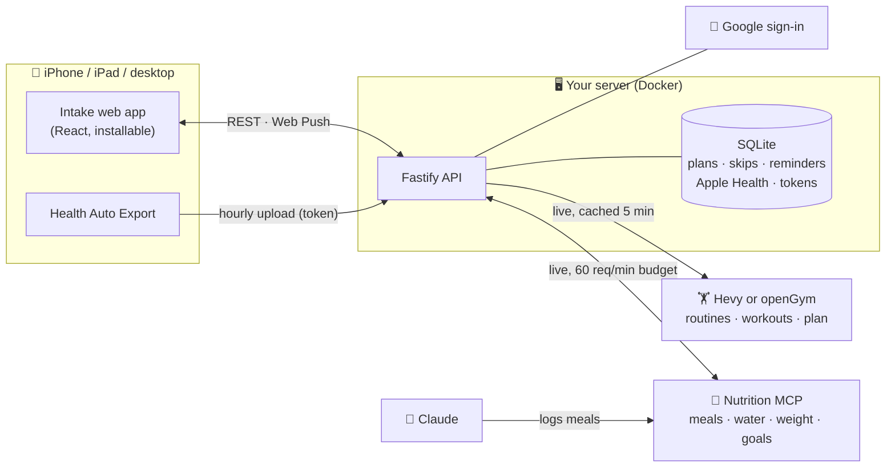

- **Live first.** Meals, water, weight and goals are read from Nutrition on every view and never stored locally; identical
  reads share one request for 30 seconds to stay under the 60 requests per minute limit.
- **Local only for what Nutrition does not have.** SQLite keeps meal plan versions, plan ↔ meal links and skips,
  reminders, push subscriptions, the encrypted tokens and the Apple Health data (Health cannot be queried from a server).
- **Health data, carefully.** No GPS routes, no all-day per-minute heart rate, no medications, mood, nutrition or weight;
  HRV and respiratory rate as daily averages. Rules in [docs/apple-health.md](docs/apple-health.md).

## 🛠️ Tech stack

| Layer | Technology |
|---|---|
| Backend | Node.js 22, TypeScript, Fastify, MCP client of the Nutrition MCP server, zod |
| Frontend | React 18, Vite, React Query, wouter, Manrope (bundled for offline use) |
| Storage | Live data from Nutrition and Hevy; local SQLite through the built-in `node:sqlite` (no native dependencies) |
| Auth | Google OpenID Connect (PKCE + nonce), owner only; Nutrition OAuth with dynamic client registration |
| Packaging | Single Docker image, docker compose, `deploy.sh` |
| CI/CD | GitHub Actions: typecheck, tests, build; deploy on a self-hosted runner; automatic releases |

## 📁 Repository layout

```
packages/shared   meal plan schema, API types shared by server and web
apps/server       Fastify server: API, auth, MCP client, Hevy, Apple Health, serves the web app
apps/web          React + Vite frontend (PWA)
schemas/          generated JSON Schema of the meal plan file
examples/         example meal plans
docs/             architecture, deployment, design, meal plan format, Apple Health, screenshots
```

## 💻 Development

Requires Node.js 22 or later.

```sh
npm install
cp .env.example .env      # fill in the values, see docs/google-sign-in.md for the Google ones
npm run dev:server        # http://localhost:3000
npm run dev:web           # http://localhost:5173, proxies /api, /auth and /connect to the server
```

For local development set `PUBLIC_BASE_URL=http://localhost:3000` and `DATA_DIR=./data` in `.env`. Then open http://localhost:3000, sign in with Google and, if needed, connect the Nutrition account once; its token is stored in `apps/server/data/intake.db`.

Other commands:

| Command | Purpose |
|---|---|
| `npm test` | Run all tests |
| `npm run typecheck` | Type-check all workspaces |
| `npm run build` | Build shared, server and web |
| `npm run capture -w @intake/server` | Save raw Nutrition MCP responses to `apps/server/captures/` (gitignored) |
| `npm run schema` | Regenerate `schemas/meal-plan.schema.json` after changing the meal plan schema |
| `npm run check:standards` | Check the machine-verifiable project rules (no secrets, tokens only, schema up to date) |

Contributions are welcome through pull requests: see [CONTRIBUTING.md](CONTRIBUTING.md) for the workflow and the standards every change must follow.

## 🚀 Deployment

See [docs/deployment.md](docs/deployment.md). In short, on the server: `bash deploy.sh --init` once (creates `.env` with generated secrets), then `bash deploy.sh` for every update (backup of the data volume, pull, Docker build, restart and health check).

## ⚙️ Configuration

All configuration comes from environment variables; see [.env.example](.env.example). Secrets never go in the repository.

## 📚 Documentation

| Document | What it covers |
|---|---|
| [docs/architecture.md](docs/architecture.md) | Components, data flow, request budget |
| [docs/deployment.md](docs/deployment.md) | Docker host, first install, updates, automatic deploy, Health upload |
| [docs/apple-health.md](docs/apple-health.md) | Health Auto Export import and sync, duplicates, scores, insights |
| [docs/meal-plan-format.md](docs/meal-plan-format.md) | Meal plan JSON format and schema |
| [docs/google-sign-in.md](docs/google-sign-in.md) | Google OAuth client setup |
| [docs/opengym.md](docs/opengym.md) | openGym as the workout source: setup, what is read, how it is shown |
| [docs/features.md](docs/features.md) | Optional parts (Allenamenti, Salute, Promemoria): what each includes, what happens when off |
| [docs/hevy-sync.md](docs/hevy-sync.md) | Copying openGym workouts to Hevy: what is copied, exercise matching, what is stored |
| [docs/design/DESIGN.md](docs/design/DESIGN.md) | Design system, navigation, approved mockups |
| [docs/backups.md](docs/backups.md) | Daily Nutrition backup: what is saved, when, retention, download |
| [CONTRIBUTING.md](CONTRIBUTING.md) | How to propose a change: fork, pull request, review, automatic deploy; project standards |
