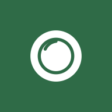

# Intake



Self-hosted nutrition dashboard with a daily meal timeline, macro tracking and meal plans, powered by the Nutrition MCP server.

## Features

### Available now

- Project scaffold: npm workspaces (`packages/shared`, `apps/server`, `apps/web`), single Docker image, docker compose.
- Meal plan file format with validation (zod) and a generated JSON Schema, including optional sugar, added sugar, saturated fat, sodium and caffeine so that meals logged from the plan are complete. See [docs/meal-plan-format.md](docs/meal-plan-format.md).
- Server health endpoint (`GET /api/health`) and environment validation at startup.
- `deploy.sh`: first install (`--init`, generates secrets) and updates with automatic data backup, Docker build, restart and health check.
- Nutrition MCP connection: one-time OAuth login at `/connect/nutrition` (dynamic client registration, PKCE), refresh token stored encrypted (AES-256-GCM) in SQLite and renewed automatically, connection status at `GET /api/nutrition/status` and `POST /api/nutrition/disconnect`.
- `npm run capture -w @intake/server` saves raw responses of the read-only Nutrition tools for building parser fixtures.
- Parsers for Nutrition MCP responses (meals with foods and all tracked nutrients, nutrition goals, current time and timezone), tested against real server output. Unrecognized fields are reported as warnings instead of being silently dropped.
- Sign in with Google, restricted to the owner's account (`OWNER_EMAIL`): OpenID Connect with PKCE and nonce, signed httpOnly session cookie valid for 30 days, sign-out. All data routes and the Nutrition connection require it. See [docs/google-sign-in.md](docs/google-sign-in.md).
- Today view: calorie ring (eaten / goal / remaining), macro bars for protein, carbs, fat and fiber with remaining or excess amounts, water in liters ("0,75 / 2,5 L") as 250 ml glasses with a quick "+250 ml" button (idempotent, optimistic update).
- Navigation: 5-slot bottom tab bar on iPhone and iPad portrait (Oggi · Settimana · [+] · Piano · Timeline) with the round "+" in the middle opening the "Aggiungi" sheet; sidebar with "+ Aggiungi" from 800 px. Only the content area scrolls, so the bars never move (iOS/iPadOS Safari moved fixed and sticky bars on long pages). The layout is pinned to the viewport, so it stays whole after rotating the device, and sheets are drawn above the whole app (sidebar included).
- Oggi shows the day's recap (calorie ring, macros, water), the next meal and a daily insight; from 1000 px the recap and the cards are two columns, on phones "Prossimo pasto" comes first. The meals are on the Timeline page.
- "Prossimo pasto" card (today, with a plan in effect): the next planned meal not yet logged or skipped (a passed one still to log comes first) with time to go or "da registrare · X fa", foods, estimated kcal, "Mangiato come previsto" (disabled with a note when the plan has no macros for it), "Altro…", "Salta" (with an "Annulla" banner), "Giornata" (opens the Timeline) and the meal after it.
- "Dai tuoi dati" insight on Oggi: one sentence from the last 7 days of the owner's own data (breakfast effect from Nutrition's meal patterns, protein per meal, weekdays vs weekend), chosen deterministically per day and hidden with fewer than 3 logged days (`GET /api/insight`, cached for an hour).
- Sign-in and one-time Nutrition connection screens; profile menu (showing the Google account name) with theme, sign-out and "Scollega Nutrition".
- Meal plans: upload the JSON file generated by Claude Fitness (its own format, schema version 1 or 2 with per-meal macros and item weights, is accepted as is, as well as Intake's format); a plan becomes active from its valid-from date and previous versions are kept as history. Piano page with day tabs (today preselected), meals with foods and quantities, "Libero" meals, plan notes, upload and version history.
- Timeline page ("date · kcal" header with previous/next day arrows, logged meals and planned meals of the selected day) with planned meals from the active plan: "Da registrare" (time passed, with "Mangiato come previsto" and "Altro…"), "Dal piano" (upcoming) and "Libero". "Salta" skips a planned meal (past or upcoming) for that day: it shows as a muted "Saltato" card with "Annulla" and counts as "N saltati", leaves the to-log count and the add sheet, and nothing is logged to Nutrition. A meal logged through Claude of the same type within 3 hours covers the planned one automatically.
- "Mangiato come previsto" logs the planned meal with its full nutrients at its planned time (idempotent); it needs per-meal macros in the plan file.
- Meal detail: kcal and share of the daily goal, macro split bar with % of goals, foods with quantities, fiber, sugar (added sugar), caffeine, saturated fat and sodium when measured; "Salva come preferito" saves it as a Nutrition saved meal.
- Edit meal: type, time, foods (rename, change quantity with nutrients scaled in proportion, remove, add with values), or totals for meals without foods; delete with confirmation (also removes it from Nutrition). On iPad and desktop, edit and delete icons in the timeline.
- "Aggiungi" sheet: water (+200 ml and +250 ml), today's plan meals, "Ripeti un pasto recente" (distinct meals of the last two weeks, logged again now); saved meals, food search and barcode are shown as coming in phase 2.
- Settimana: daily calories as bars against the goal line (tap a day to open it), previous/next week, average kcal and protein over the completed logged days (today is left out until it is over), a "Costanza" card (logging streak, days on the protein and water targets with the best day when missed, meals eaten as planned and skipped), weight card with the latest weigh-in, change since the previous one, target, and a field to log the weekly weigh-in.
- Week strip (Monday to Sunday) on Oggi to switch day; the selected day is kept in the URL.
- Meal timeline with logged meals (foods with quantities, kcal, macro chips) and a "now" marker for today; without a plan in effect it says so and links to Piano.
- Nutrition request budget: the Nutrition MCP server allows 60 requests per minute, so identical reads within 30 seconds share one request (in memory only, cleared by any write) and the clock is computed locally from the profile timezone. When the limit is hit the app says so and retries after the delay the server asks for.
- UI built from the approved design in `docs/design/` (Manrope, design tokens), in Italian with Italian number and date formatting; responsive (iPhone, iPad, desktop); light and dark mode following the system, with a manual Sistema / Chiaro / Scuro choice saved per device.
- Day API: `GET /api/days/:date` (or `today`, in the Nutrition profile's timezone) and `POST /api/water`.
- Installable on iPhone via Safari "Add to Home Screen" (web app manifest and icons, safe-area aware, light and dark themes).

### Planned – phase 2

- Saved meals, food search with quantity and barcode scan in the "Aggiungi" sheet.
- Allenamenti with workouts from Hevy.
- Automated deploy via GitHub Actions.

## Tech stack

- Backend: Node.js 22, TypeScript, Fastify, MCP client of the Nutrition MCP server.
- Frontend: React, Vite.
- Storage: live data from the Nutrition MCP server; local SQLite (`node:sqlite`, no native dependencies) only for meal plans and tokens.
- Packaging: Docker and docker compose.

## Repository layout

```
packages/shared   meal plan schema and types shared by server and web
apps/server       Fastify server: API, auth, MCP client, serves the web app
apps/web          React + Vite frontend (PWA)
schemas/          generated JSON Schema of the meal plan file
examples/         example meal plan
docs/             architecture, deployment, meal plan format
```

## Development

Requires Node.js 22 or later.

```sh
npm install
cp .env.example .env      # fill in the values, see docs/google-sign-in.md for the Google ones
npm run dev:server        # http://localhost:3000
npm run dev:web           # http://localhost:5173, proxies /api, /auth and /connect to the server
```

For local development set `PUBLIC_BASE_URL=http://localhost:3000` and `DATA_DIR=./data` in `.env`. Then open http://localhost:3000, sign in with Google and, if needed, connect the Nutrition account once; its token is stored in `apps/server/data/intake.db`.

Other commands:

| Command | Purpose |
|---|---|
| `npm test` | Run all tests |
| `npm run typecheck` | Type-check all workspaces |
| `npm run build` | Build shared, server and web |
| `npm run capture -w @intake/server` | Save raw Nutrition MCP responses to `apps/server/captures/` (gitignored) |
| `npm run schema` | Regenerate `schemas/meal-plan.schema.json` after changing the meal plan schema |

## Deployment

See [docs/deployment.md](docs/deployment.md). In short, on the server: `bash deploy.sh --init` once (creates `.env` with generated secrets), then `bash deploy.sh` for every update (backup of the data volume, pull, Docker build, restart and health check).

## Configuration

All configuration comes from environment variables; see [.env.example](.env.example). Secrets never go in the repository.
