<div align="center">


# Intake

**A self-hosted nutrition and health dashboard for one person**
Daily meal timeline · macros · meal plans · Apple Health sleep, activity and heart · Hevy workouts

<p>
  
  
  
  
  
  
  
  
  
</p>

<p>
  <a href="#-screenshots">Screenshots</a> ·
  <a href="#-features">Features</a> ·
  <a href="#-how-it-works">How it works</a> ·
  <a href="#-development">Development</a> ·
  <a href="#-deployment">Deployment</a> ·
  <a href="#-documentation">Docs</a>
</p>

</div>

---

Intake reads what you log by talking to Claude (meals, water, weight, goals) **live** from the
[Nutrition MCP server](https://nutrition-mcp.com/mcp), lays it out as a timeline next to your meal plan, and adds sleep,
steps, heart rate and workouts from **Apple Health** and **Hevy**. It runs on your own server, signs in only you, and works
as an installed app on iPhone, iPad and desktop, in light and dark mode. The interface is in Italian.

## ✨ Highlights

| | |
|---|---|
| 🎯 **Sforzo · Recupero · Sonno** | Three daily percentages on Oggi, computed from workouts, resting heart rate, respiratory rate, sleep and (with an Apple Watch) HRV. Tap a ring to see how it is calculated. |
| 🕒 **Timeline** | Meals, the planned meals still to log, workouts with their heart-rate curve and last night's sleep on one rod, with a "now" marker. |
| 📋 **Meal plans** | Upload the plan generated by Claude Fitness; log a planned meal with one tap, skip it, and compare plan and reality. |
| 📊 **Andamento** | Weekly nutrition (calories, protein, kcal share, consistency) and health trends over 7, 30 or 90 days. |
| ❤️ **Apple Health** | Automatic hourly sync from Health Auto Export, or file import with a preview; duplicates across Fitbit, MERACH, Bevel and Hevy merged into one session. |
| 🔔 **Reminders** | Web Push to the installed app: planned meals, water, the evening summary. |
| 🔒 **Private by design** | Google sign-in for the owner only, secrets encrypted at rest, nutrition data never copied to the local database. |

## 📸 Screenshots

> Screenshots use made-up demo data.

<table>
  <tr>
    <td align="center">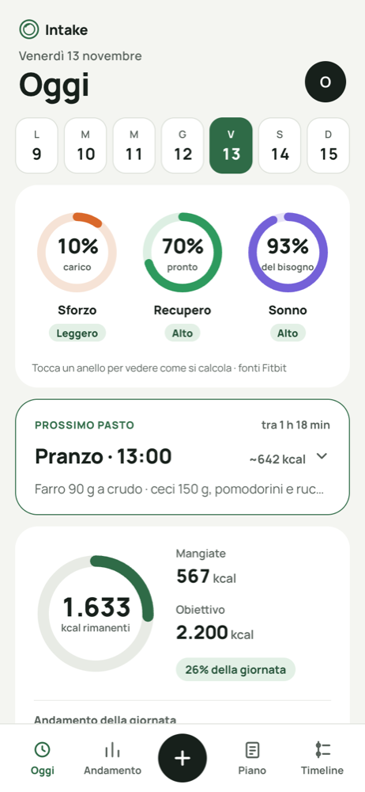<br /><sub><b>Oggi</b> · rings, next meal, calories</sub></td>
    <td align="center">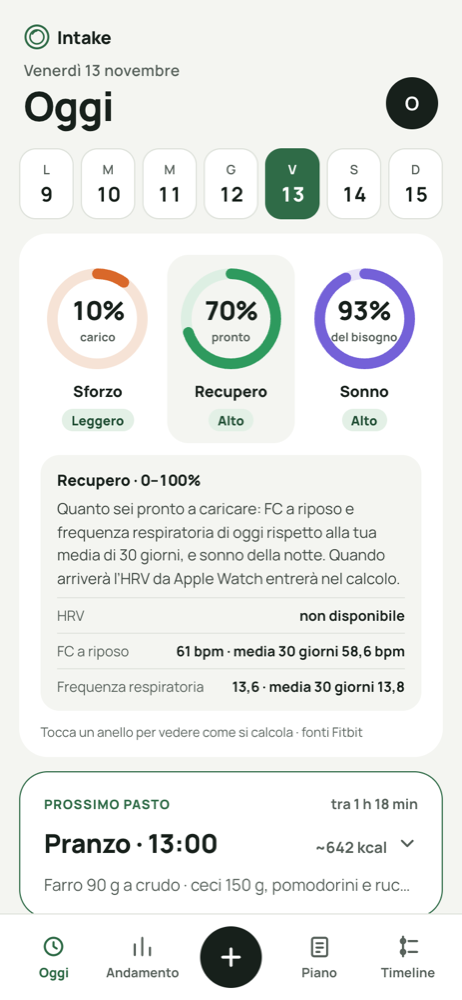<br /><sub><b>Recupero</b> · how it is calculated</sub></td>
    <td align="center">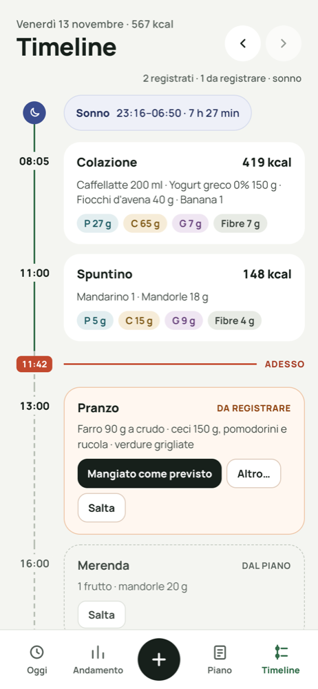<br /><sub><b>Timeline</b> · meals, plan, now</sub></td>
    <td align="center">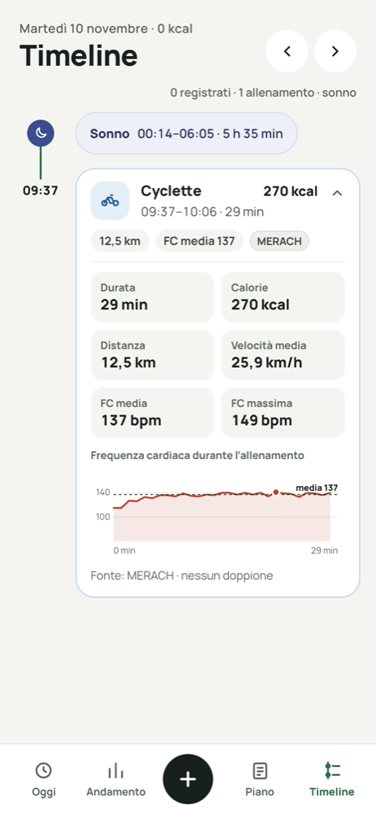<br /><sub><b>Workout</b> · heart-rate curve</sub></td>
  </tr>
  <tr>
    <td align="center">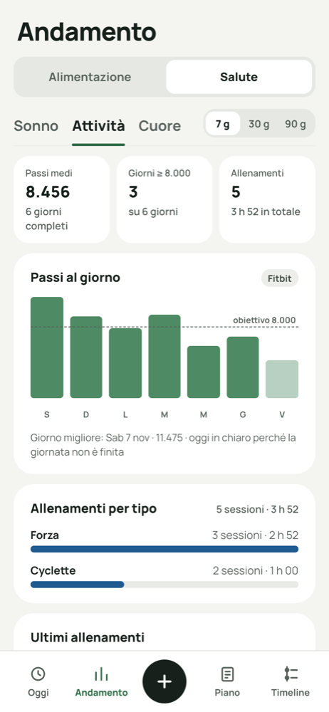<br /><sub><b>Andamento › Salute</b></sub></td>
    <td align="center">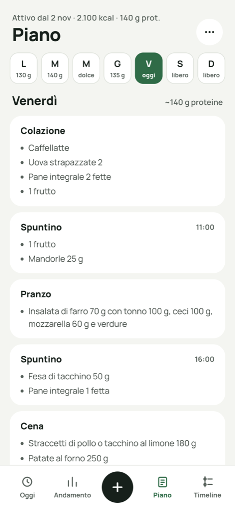<br /><sub><b>Piano</b> · the week's plan</sub></td>
    <td align="center">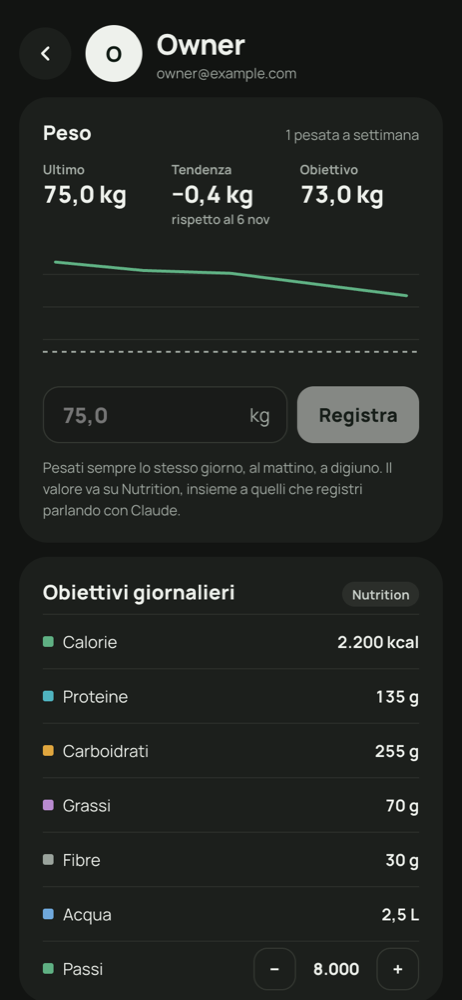<br /><sub><b>Profilo</b> · dark mode</sub></td>
    <td align="center">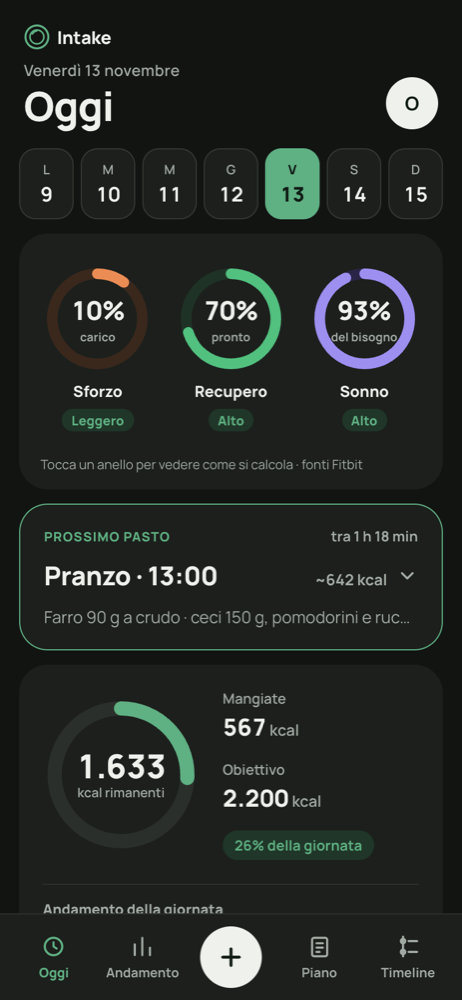<br /><sub><b>Oggi</b> · dark mode</sub></td>
  </tr>
</table>

<p align="center">
  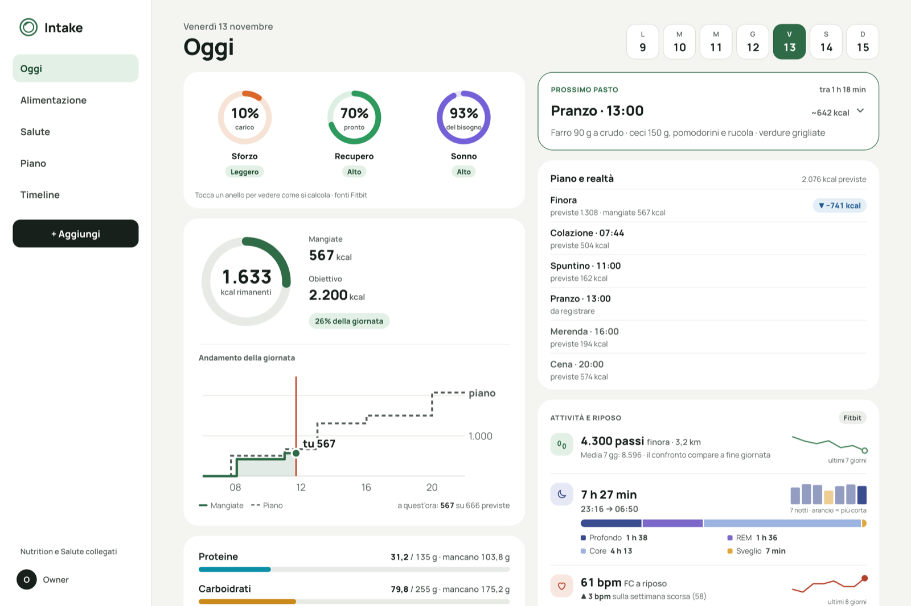<br />
  <sub><b>Oggi on desktop</b> · sticky sidebar, two columns</sub>
</p>

<table>
  <tr>
    <td align="center">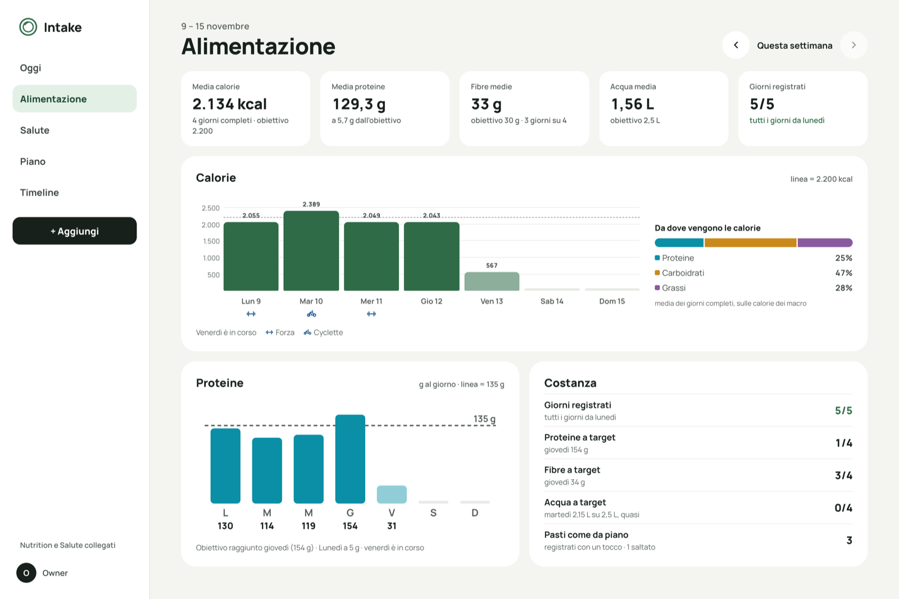<br /><sub><b>Andamento › Alimentazione</b></sub></td>
    <td align="center">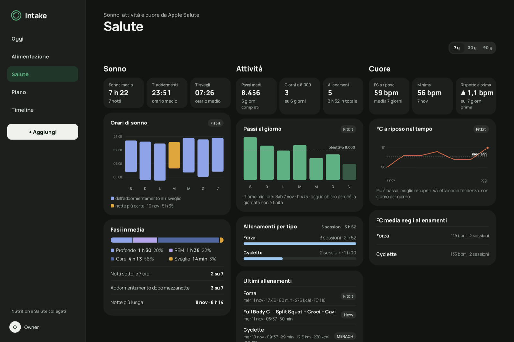<br /><sub><b>Andamento › Salute</b> · dark mode</sub></td>
  </tr>
</table>

## 🧩 Features

<details open>
<summary><b>🏠 Oggi</b></summary>

- Sforzo, Recupero and Sonno rings at the top of Oggi (after an Apple Health import): three percentages with a text state (Leggero / Moderato / Intenso, Basso / Medio / Alto); tap a ring for "come si calcola" with the day's inputs. Sforzo from workout heart rate (TRIMP) and the day's movement; Sonno against an 8-hour need with a bedtime-regularity correction; Recupero from HRV when an Apple Watch writes it, otherwise resting heart rate and respiratory rate against the personal 30-day baseline, plus Sonno ("in calibrazione" until there is enough history). Rules in [docs/apple-health.md](docs/apple-health.md) (`GET /api/health/scores/:date`).
- Today view: calorie ring (eaten / goal / remaining) with "Andamento della giornata" under it (kcal eaten through the day as a stepped line with area against the plan as a dashed stepped line, 06–22, the "now" marker and "a quest'ora: X su Y previste"; hidden on days without meals or plan), macro bars for protein, carbs, fat and fiber with remaining or excess amounts, water in liters ("0,75 / 2,5 L") as 250 ml glasses with a quick "+250 ml" button (idempotent, optimistic update).
- Oggi shows the day's recap (calorie ring, macros, water), the next meal and a daily insight; from 1000 px the recap and the cards are two columns, on phones "Prossimo pasto" comes first. The meals are on the Timeline page.
- "Prossimo pasto" card (today, with a plan in effect), collapsed by default to title, time, kcal and a one-line summary, tap to expand: the next planned meal not yet logged or skipped (a passed one still to log comes first) with time to go or "da registrare · X fa", foods, estimated kcal, "Mangiato come previsto" (disabled with a note when the plan has no macros for it), "Altro…", "Salta" (with an "Annulla" banner), "Giornata" (opens the Timeline) and the meal after it.
- "Piano e realtà" on Oggi: planned kcal so far (or for the whole day, on past days) against what was eaten, then each planned meal with planned and logged kcal ("previste 450 · mangiate 574 kcal") and a labeled difference ("▲ +124 kcal", "▼ −80 kcal", "in linea" within 30 kcal or 5%), skipped, to-log and free meals, and the meals logged outside the plan. Shown when the plan in effect has per-meal macros.
- "Dai tuoi dati" insight on Oggi: one sentence from the owner's own data, chosen deterministically per day and hidden with fewer than 3 logged days in the last week (`GET /api/insight`, cached for an hour). From the last 7 days: breakfast effect from Nutrition's meal patterns, protein per meal, weekdays vs weekend. With Apple Health, over the last 28 completed days: kcal after a night under 7 hours against the other days, and kcal on days at the step goal against the others, only when each group has at least 5 logged days and the gap is at least 10%. The window under the sentence says which period it looks at.
- "Attività e riposo" on Oggi (after an Apple Health import): steps with distance and a 7-day sparkline (today shows "finora" and the 7-day average as context; finished days show the % against that average), last night's sleep with bed and wake times, a 7-night bar chart (shortest night in amber) and a phase bar with labeled minutes, and resting heart rate against the previous week with an 8-day sparkline; source pill, "Aggiornato oggi alle HH:MM" or a stale state, and "Nessun dato da Salute per questo giorno" on empty days. Rows without data are hidden (`GET /api/health/days/:date`).
- Week strip (Monday to Sunday) on Oggi to switch day; the selected day is kept in the URL.

</details>

<details>
<summary><b>🕒 Timeline</b></summary>

- Timeline page ("date · kcal" header with previous/next day arrows, logged meals and planned meals of the selected day) with planned meals from the active plan: "Da registrare" (time passed, with "Mangiato come previsto" and "Altro…"), "Dal piano" (upcoming) and "Libero". "Salta" skips a planned meal (past or upcoming) for that day: it shows as a muted "Saltato" card with "Annulla" and counts as "N saltati", leaves the to-log count and the add sheet, and nothing is logged to Nutrition. A meal logged through Claude of the same type covers the planned one automatically when it is logged from 1 hour before to 3 hours after the planned time and, if the plan has macros, has at least 40% of the planned kcal (a coffee logged as a snack does not cover the afternoon snack).
- Meal timeline with logged meals (foods with quantities, kcal, macro chips) and a "now" marker for today; without a plan in effect it says so and links to Piano.
- "Mangiato come previsto" logs the planned meal with its full nutrients at its planned time (idempotent); it needs per-meal macros in the plan file.
- Sleep on the Timeline: a chip at wake-up time with bed and wake times and total, which opens the phase bar (deep / REM / core / awake) with labeled minutes.
- Workouts from Hevy (optional `HEVY_API_KEY`, Hevy Pro) and Apple Health in the day's Timeline at their start time: a card with a type icon, title, kcal when known, time range, duration and type, chips (exercises, distance, average heart rate) and the source; tap to open the stats (duration, sets, volume, kcal, distance, average speed, average and max heart rate), the heart-rate curve during the session with the dashed average and the max point, the Hevy exercises with sets and heaviest set, and a "Fonti" line (which app gave title, heart rate and kcal, duplicates discarded). A Health session that is the same as a Hevy workout only adds heart rate and kcal to it; Hevy keeps title, exercises and duration. Andamento › Alimentazione marks them under the calorie chart. Hevy is read live (pages cached in memory for 5 minutes); when Hevy is down the Health workouts are still listed and the rest of the app keeps working (`GET /api/workouts`).

</details>

<details>
<summary><b>📊 Andamento (Alimentazione · Salute)</b></summary>

- Andamento › Alimentazione (formerly Settimana), from the 13 Nov design: daily calories as bars against the goal line (tap a day to open it) with the week's workouts as type icons under each day and a legend, previous/next week, "Da dove vengono le calorie" (share of protein, carbs and fat in the macro calories), protein per day against the goal line, KPI tiles (average kcal and protein over the completed logged days; from tablet width also fiber, water and days logged; today is left out until it is over), and a "Costanza" card (days logged this week, days on the protein, fiber and water targets with the best day when missed, meals eaten as planned and skipped). On tablet and desktop: "Questa settimana" between the week arrows, KPI row and a card grid with Calorie across the full width, with a kcal scale and "Lun 9" day labels; the protein note names the days at the goal with their grams and the day that came closest (`GET /api/weeks/:date`).
- "Piano e realtà" on Andamento › Alimentazione: average daily difference from the plan over completed days without free meals, each completed day planned against eaten, and the three planned meals that differed most.
- Andamento › Salute (after an Apple Health import, SQLite only, no Nutrition calls): period 7 / 30 / 90 days; Sonno (average sleep, mean fall-asleep and wake time averaged across midnight, floating bars from falling asleep to waking with the shortest night in amber, average phases, nights under 7 hours, falling asleep after midnight, longest night), Attività (average steps over finished days, days at the step goal, daily bars with the dashed goal and today drawn light, best day, workouts by type, latest four workouts with their source), Cuore (average and minimum resting heart rate, change from the previous period of the same length, line over time with the average, average workout heart rate by type). Tabs on phones and tablets, three columns from 1100 px. "Vedi andamento →" on the Oggi card opens it (`GET /api/health/trends?days=7|30|90`).

</details>

<details>
<summary><b>🍽️ Meals: detail, edit, add</b></summary>

- Meal detail: kcal and share of the daily goal, macro split bar with % of goals, foods with quantities, fiber, sugar (added sugar), caffeine, saturated fat and sodium when measured; "Salva come preferito" saves it as a Nutrition saved meal.
- Edit meal: type, time, foods (rename, change quantity with nutrients scaled in proportion, remove, add with values), or totals for meals without foods; delete with confirmation (also removes it from Nutrition). On iPad and desktop, edit and delete icons in the timeline.
- "Aggiungi" sheet: water (+200 ml and +250 ml), today's plan meals, "Ripeti un pasto recente" (distinct meals of the last two weeks, logged again now), "Chiedi a Claude" (opens Claude to log a photo or a free description); saved meals are shown as coming soon.

</details>

<details>
<summary><b>📋 Meal plans</b></summary>

- Meal plans: upload the JSON file generated by Claude Fitness (its own format, schema version 1 or 2 with per-meal macros and item weights, is accepted as is, as well as Intake's format); a plan becomes active from its valid-from date and previous versions are kept as history. Piano page with day tabs (today preselected), meals with foods and quantities, "Libero" meals, plan notes, upload and version history.
- Meal plan file format with validation (zod) and a generated JSON Schema, including optional sugar, added sugar, saturated fat, sodium and caffeine so that meals logged from the plan are complete. See [docs/meal-plan-format.md](docs/meal-plan-format.md).

</details>

<details>
<summary><b>❤️ Apple Health</b></summary>

- Apple Salute (Profilo › Collegamenti): data status (last data, period, days, workouts), data coverage per metric and day (present / irregular / missing), sources, a warning when active energy stops arriving regularly with steps to fix it. File import of a Health Auto Export JSON export (up to 50 MB) with a preview first: recognized metrics with irregular ones flagged, workouts by type with the duplicates resolved, ignored data; re-importing a period updates it without duplicates. Steps, distance, sleep, resting heart rate, active and resting energy and workouts are stored in SQLite (`POST /api/health/import`, `GET /api/health/status`, `PUT /api/health/settings`). See [docs/apple-health.md](docs/apple-health.md).
- Automatic upload from Health Auto Export (Profilo › Apple Salute › "Sincronizzazione automatica"): a switch creates a secret token (stored encrypted; "Copia", "Rigenera"), the screen shows the endpoint URL, the last upload received and the steps for the app's "REST API" automation. `POST /api/health/ingest` is outside Google sign-in, needs `Authorization: Bearer <token>` and saves the data like the file import. See [docs/apple-health.md](docs/apple-health.md) and, behind Cloudflare Access, the bypass in [docs/deployment.md](docs/deployment.md).

</details>

<details>
<summary><b>👤 Profile, reminders and sign-in</b></summary>

- Profilo (from the avatar on Oggi or the profile row in the sidebar): weight card (latest weigh-in, change since the previous one, target, a line chart from the second weigh-in and a field to log the weekly weigh-in), daily goals from Nutrition (calories, protein, carbs, fat, fiber, water; read-only) plus the step goal with − / +, connections (Google, Nutrition, Apple Salute with "attenzione" when active energy stops arriving, Hevy), "Promemoria", theme (Sistema / Chiaro / Scuro, per device), "Scollega Nutrition" and "Esci". Two columns from 900 px (`GET /api/profile`, `POST /api/weight`).
- Reminders (Web Push to the installed home-screen app, iOS 16.4+): at the time of a planned meal not yet logged or skipped, 45 minutes later if it is still not logged, water at 16:00 and 20:00 when behind the goal for that time of day, and a 21:30 summary of kcal and protein. "Promemoria" in Profilo turns notifications on per device, chooses the reminders and sends a test. The server checks once a minute from the plan times and reads Nutrition only when a reminder is due; each reminder is sent at most once. VAPID keys are generated on first start and stored encrypted.
- Sign-in and one-time Nutrition connection screens.
- Sign in with Google, restricted to the owner's account (`OWNER_EMAIL`): OpenID Connect with PKCE and nonce, signed httpOnly session cookie valid for 30 days, sign-out. All data routes and the Nutrition connection require it. See [docs/google-sign-in.md](docs/google-sign-in.md).

</details>

<details>
<summary><b>🧭 Navigation and interface</b></summary>

- Navigation: 5-slot bottom tab bar on iPhone and iPad portrait (Oggi · Andamento · [+] · Piano · Timeline) with the round "+" in the middle opening the "Aggiungi" sheet; sidebar from 800 px (Oggi · Alimentazione · Salute · Piano · Timeline, "+ Aggiungi", "Nutrition collegato" or "Nutrition e Salute collegati", and the profile row); on phones Andamento opens with an "Alimentazione | Salute" switch. Old addresses (`/settimana`, `/salute`) redirect to the new ones. Only the content area scrolls, so the bars never move (iOS/iPadOS Safari moved fixed and sticky bars on long pages). In the installed app the layout is 100lvh (the full screen): on a foldable iPhone the measured viewport is 82 px short after rotating or switching apps, and 100dvh can lag behind. In Safari the layout height follows the visual viewport, measured again after rotations, because Safari sizes 100dvh and fixed elements for a toolbar that is no longer shown; transient sizes while folding are ignored. Sheets are drawn above the whole app (sidebar included).
- UI built from the approved design in `docs/design/` (Manrope, design tokens), in Italian with Italian number and date formatting; responsive (iPhone, iPad, desktop); light and dark mode following the system, with a manual Sistema / Chiaro / Scuro choice saved per device.
- Installable on iPhone via Safari "Add to Home Screen" (web app manifest and icons, safe-area aware, light and dark themes).

</details>

<details>
<summary><b>⚙️ Platform</b></summary>

- Project scaffold: npm workspaces (`packages/shared`, `apps/server`, `apps/web`), single Docker image, docker compose.
- Server health endpoint (`GET /api/health`) and environment validation at startup.
- `deploy.sh`: first install (`--init`, generates secrets) and updates with automatic data backup, Docker build, restart and health check.
- Continuous integration and automatic deploy: GitHub Actions runs typecheck, tests and build on every pull request and push to `main`; when it passes on `main`, a self-hosted runner on the Docker host runs `deploy.sh`, then the deployed commit is tagged and published as a GitHub release (`v0.1.0`, `v0.1.1`, …; see [docs/deployment.md](docs/deployment.md)).
- Nutrition MCP connection: one-time OAuth login at `/connect/nutrition` (dynamic client registration, PKCE), refresh token stored encrypted (AES-256-GCM) in SQLite and renewed automatically, connection status at `GET /api/nutrition/status` and `POST /api/nutrition/disconnect`.
- `npm run capture -w @intake/server` saves raw responses of the read-only Nutrition tools for building parser fixtures.
- Parsers for Nutrition MCP responses (meals with foods and all tracked nutrients, nutrition goals, current time and timezone), tested against real server output. Unrecognized fields are reported as warnings instead of being silently dropped.
- Nutrition request budget: the Nutrition MCP server allows 60 requests per minute, so identical reads within 30 seconds share one request (in memory only, cleared by any write) and the clock is computed locally from the profile timezone. When the limit is hit the app says so and retries after the delay the server asks for.
- Day API: `GET /api/days/:date` (or `today`, in the Nutrition profile's timezone) and `POST /api/water`.

</details>

### 🗺️ Planned

- Saved meals in the "Aggiungi" sheet.
- "Personalizza" on Alimentazione (desktop/iPad): move, resize and hide cards.

## 🔧 How it works

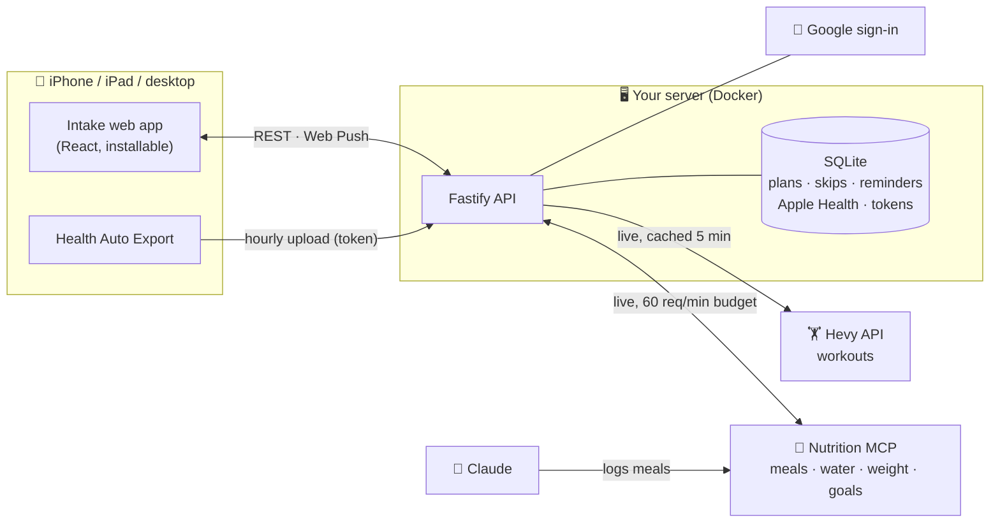

- **Live first.** Meals, water, weight and goals are read from Nutrition on every view and never stored locally; identical
  reads share one request for 30 seconds to stay under the 60 requests per minute limit.
- **Local only for what Nutrition does not have.** SQLite keeps meal plan versions, plan ↔ meal links and skips,
  reminders, push subscriptions, the encrypted tokens and the Apple Health data (Health cannot be queried from a server).
- **Health data, carefully.** No GPS routes, no all-day per-minute heart rate, no medications, mood, nutrition or weight;
  HRV and respiratory rate as daily averages. Rules in [docs/apple-health.md](docs/apple-health.md).

## 🛠️ Tech stack

| Layer | Technology |
|---|---|
| Backend | Node.js 22, TypeScript, Fastify, MCP client of the Nutrition MCP server, zod |
| Frontend | React 18, Vite, React Query, wouter, Manrope (bundled for offline use) |
| Storage | Live data from Nutrition and Hevy; local SQLite through the built-in `node:sqlite` (no native dependencies) |
| Auth | Google OpenID Connect (PKCE + nonce), owner only; Nutrition OAuth with dynamic client registration |
| Packaging | Single Docker image, docker compose, `deploy.sh` |
| CI/CD | GitHub Actions: typecheck, tests, build; deploy on a self-hosted runner; automatic releases |

## 📁 Repository layout

```
packages/shared   meal plan schema, API types shared by server and web
apps/server       Fastify server: API, auth, MCP client, Hevy, Apple Health, serves the web app
apps/web          React + Vite frontend (PWA)
schemas/          generated JSON Schema of the meal plan file
examples/         example meal plans
docs/             architecture, deployment, design, meal plan format, Apple Health, screenshots
```

## 💻 Development

Requires Node.js 22 or later.

```sh
npm install
cp .env.example .env      # fill in the values, see docs/google-sign-in.md for the Google ones
npm run dev:server        # http://localhost:3000
npm run dev:web           # http://localhost:5173, proxies /api, /auth and /connect to the server
```

For local development set `PUBLIC_BASE_URL=http://localhost:3000` and `DATA_DIR=./data` in `.env`. Then open http://localhost:3000, sign in with Google and, if needed, connect the Nutrition account once; its token is stored in `apps/server/data/intake.db`.

Other commands:

| Command | Purpose |
|---|---|
| `npm test` | Run all tests |
| `npm run typecheck` | Type-check all workspaces |
| `npm run build` | Build shared, server and web |
| `npm run capture -w @intake/server` | Save raw Nutrition MCP responses to `apps/server/captures/` (gitignored) |
| `npm run schema` | Regenerate `schemas/meal-plan.schema.json` after changing the meal plan schema |

## 🚀 Deployment

See [docs/deployment.md](docs/deployment.md). In short, on the server: `bash deploy.sh --init` once (creates `.env` with generated secrets), then `bash deploy.sh` for every update (backup of the data volume, pull, Docker build, restart and health check).

## ⚙️ Configuration

All configuration comes from environment variables; see [.env.example](.env.example). Secrets never go in the repository.

## 📚 Documentation

| Document | What it covers |
|---|---|
| [docs/architecture.md](docs/architecture.md) | Components, data flow, request budget |
| [docs/deployment.md](docs/deployment.md) | Docker host, first install, updates, automatic deploy, Health upload |
| [docs/apple-health.md](docs/apple-health.md) | Health Auto Export import and sync, duplicates, scores, insights |
| [docs/meal-plan-format.md](docs/meal-plan-format.md) | Meal plan JSON format and schema |
| [docs/google-sign-in.md](docs/google-sign-in.md) | Google OAuth client setup |
| [docs/design/DESIGN.md](docs/design/DESIGN.md) | Design system, navigation, approved mockups |
